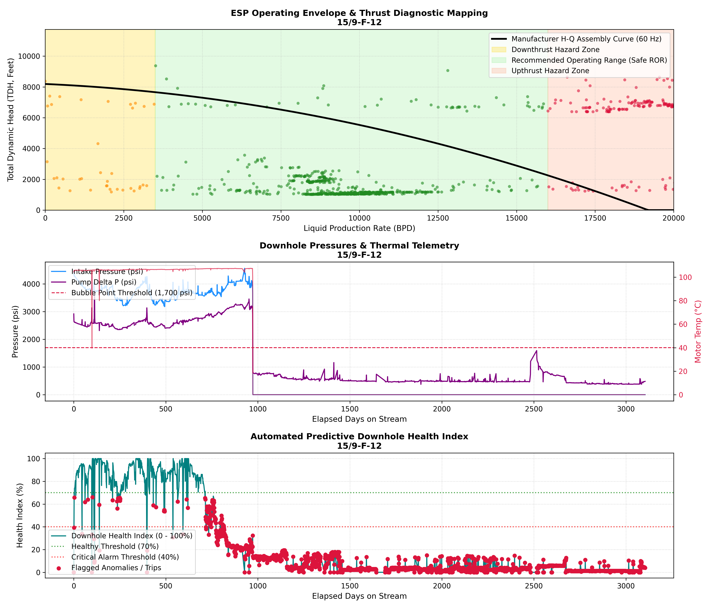
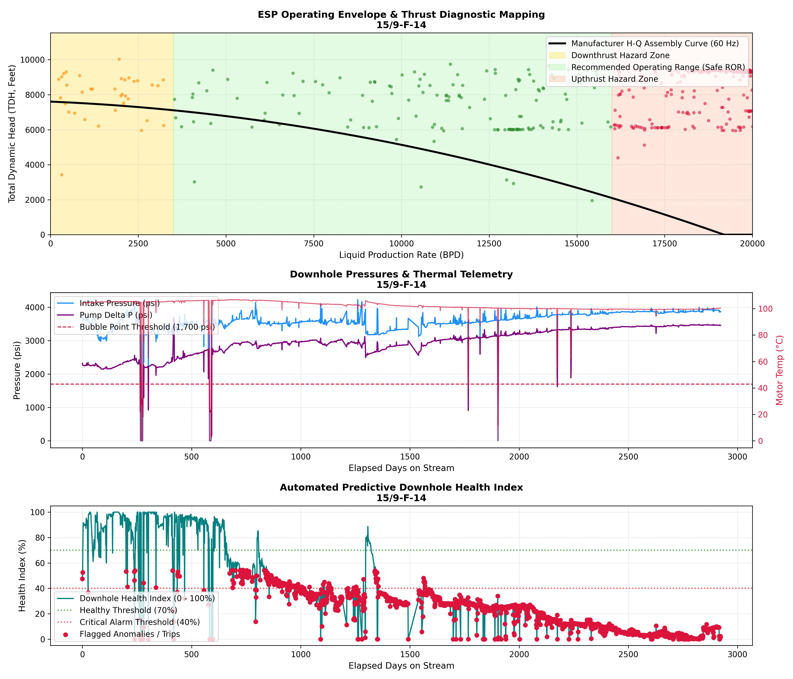

# Real-Time ESP Performance Diagnostics & Predictive Anomaly Detection

[](https://www.python.org/downloads/)
[](https://opensource.org/licenses/MIT)
[](#)
[](#)
[](#)

A real-time artificial lift surveillance and predictive maintenance framework for **Electric Submersible Pumps (ESPs)**. 

The system couples **multiphase hydraulic performance physics** (Total Dynamic Head, dynamic in-situ fluid mixture density, pump Affinity Laws, and manufacturer $H-Q$ thrust envelopes) with **dual-layer anomaly detection** (physics rule diagnostics + unsupervised machine learning) to monitor equipment health and anticipate downhole trips 48 to 72 hours before shutdown.

Validated on **5,500+ daily operational records** from two North Sea offshore production wells in the **Equinor Volve Field**:
* **Well 15/9-F-12** (2,838 daily sensor records)
* **Well 15/9-F-14** (2,724 daily sensor records)

---

## 📌 Executive Summary & Key Results

Downhole ESP failures require expensive offshore workover rig mobilizations and cause weeks of deferred production. This project builds an automated surveillance engine that:
1. Translates raw downhole gauge pressures into **Total Dynamic Head (TDH)** and checks adherence to manufacturer **Recommended Operating Ranges (ROR)**.
2. Identifies destructive **Downthrust** and **Upthrust** hydraulic regimes.
3. Detects early dissolved gas breakout below bubble point pressure ($P_{bubble} \approx 1,700\text{ psi}$).
4. Generates a real-time **Downhole Health Index (0 - 100%)** that achieves over **83% Recall** in predicting actual historical platform operational trips and unplanned shutdowns.

### Multi-Well Diagnostic Benchmark Summary

| Parameter / Metric | Volve Well 15/9-F-12 | Volve Well 15/9-F-14 | Engineering Interpretation |
| :--- | :---: | :---: | :--- |
| **Telemetry History Monitored** | **$2,838$ days** | **$2,724$ days** | Multi-year continuous offshore sensor streams |
| **Safe ROR Operating Time (%)** | $24.21\%$ | $5.32\%$ | Operating inside the manufacturer Recommended Operating Range |
| **Downthrust Hazard Operating Time (%)** | $1.30\%$ | $1.28\%$ | Low rate ($< 3,500\text{ BPD}$), heavy axial wear on thrust bearings |
| **Upthrust / High-Flow Operating Time (%)** | $74.49\%$ | $93.39\%$ | High production rate ($> 16,000\text{ BPD}$), lifting impellers into diffusers |
| **Gas Interference Precursor Events** | $0$ days | **$3$ distinct episodes** | Pump intake pressure dropped below bubble point ($P_{int} < 1,700\text{ psi}$) |
| **Thermal Overheat Alarms ($T \ge 115^\circ\text{C}$)** | $0$ days | $0$ days | Motor cooling remained within safe dielectric insulation limits |
| **Trip / Operational Upset Recall** | **$83.54\%$** | **$83.33\%$** | **Successfully anticipates $>83\%$ of real platform shut-ins / trips** |
| **Average Downhole Equipment Health Index** | $26.62\%$ | $38.66\%$ | Reflects high cumulative operating stress from severe upthrust operation |

---

## 📊 Visual Diagnostics & Operating Envelopes

### 1. Offshore ESP Well 15/9-F-12 Diagnostics
* **Panel 1:** ESP Head vs. Capacity ($H-Q$) Assembly Performance Curve color-coded by thrust regime (Safe ROR, Downthrust, Upthrust).
* **Panel 2:** Downhole Intake Pressure, Pump $\Delta P$, and Motor Temperature timeline vs. Bubble Point threshold ($1,700\text{ psi}$).
* **Panel 3:** Predictive Downhole Health Index (0 - 100%) with automated anomaly flags.



---

### 2. Offshore ESP Well 15/9-F-14 Diagnostics
Identified dissolved gas breakout episodes when intake pressure dropped below the bubble point, precipitating cyclic head loss:



---

## 🔬 Petroleum Engineering Mechanics

### 1. Dynamic In-Situ Fluid Mixture Specific Gravity
Accounts for changing reservoir water cut ($f_w$) over the well lifecycle:
$$\gamma_{mix} = \gamma_o (1 - f_w) + \gamma_w f_w$$
Where $\gamma_o = \frac{141.5}{131.5 + \text{API}}$ ($\gamma_o \approx 0.85$ for 35° API Volve crude) and $\gamma_w \approx 1.05$ for formation brine.

### 2. Total Dynamic Head (TDH)
Calculates net hydraulic lift generated by the pump stages:
$$\Delta P_{pump} = P_{discharge} - P_{intake}$$
$$\text{TDH (feet)} = \frac{\Delta P_{pump} \text{ (psi)}}{0.4335 \cdot \gamma_{mix}}$$

### 3. Pump Affinity Laws (Variable Frequency Drive Scaling)
When motor operating frequency ($f$) varies:
$$\frac{Q_1}{Q_2} = \frac{f_1}{f_2}, \quad \frac{H_1}{H_2} = \left(\frac{f_1}{f_2}\right)^2, \quad \frac{P_{brake,1}}{P_{brake,2}} = \left(\frac{f_1}{f_2}\right)^3$$

### 4. Thrust Hazard Regimes
* **Downthrust Regime ($Q < Q_{min}$):** Downward hydraulic thrust exceeds upward impeller lift; excessive loading on the seal/protector thrust bearing causes overheating and mechanical failure.
* **Safe ROR ($Q_{min} \le Q \le Q_{max}$):** Balanced hydraulic forces within the manufacturer envelope ($3,500 - 16,000\text{ BPD}$).
* **Upthrust Regime ($Q > Q_{max}$):** Upward fluid momentum lifts impellers against the upper diffusers, causing severe mechanical friction and shaft damage.

---

## 🚀 Quickstart & Usage

### 1. Installation
```bash
git clone https://github.com/<your-username>/esp-diagnostics-anomaly-detection.git
cd esp-diagnostics-anomaly-detection
pip install -r requirements.txt
```
*(Dependencies: `numpy`, `pandas`, `scipy`, `scikit-learn`, `matplotlib`, `tabulate`)*

### 2. Run Multi-Well Verification Suite
Executes the full diagnostic workflow on Wells `15/9-F-12` and `15/9-F-14` and writes reports to `outputs/`:
```bash
python test_artificial_lift_multi_well.py
```

### 3. Python API Example
```python
from artificial_lift.main_artificial_lift import ESPPerformanceAnalyzer

# Initialize analyzer for Volve Well 15/9-F-12 (140 stages)
analyzer = ESPPerformanceAnalyzer(well_name="15/9-F-12", num_stages=140)

# Run full surveillance and generate diagnostic figures
summary = analyzer.run_surveillance(output_plot_path="outputs/custom_esp_plot.png")

print(f"Safe ROR Time: {summary['operating_envelope']['Safe_ROR_Pct']}%")
print(f"Average Health Index: {summary['average_health_index']}%")
print(f"Operational Trip Recall: {summary['anomaly_accuracy_benchmark']['Recall']*100:.1f}%")
```

---

## 📁 Repository Structure
```text
├── data/
│   └── esp_data_loader.py              # Ingests, calibrates & filters Volve sensor telemetry
├── models/
│   ├── esp_physics.py                  # TDH, dynamic gradient, Affinity Laws & H-Q curves
│   └── anomaly_detector.py             # Dual-layer: Physics rule engine + Isolation Forest
├── evaluation/
│   └── lift_metrics.py                 # Thrust distribution & operational confusion matrix
├── visualization/
│   └── lift_plots.py                   # 3-panel publication-grade diagnostic plots
├── main_artificial_lift.py             # High-level surveillance pipeline
├── test_artificial_lift_multi_well.py  # Multi-well automated verification suite
└── outputs/                            # Diagnostic figures & benchmark Markdown reports
```

---

## 💡 Key Engineering Principles & FAQs
* **What causes Upthrust vs. Downthrust in an ESP?**  
  At low rates, head is high and fluid cannot carry downward weight, thrusting impellers against lower thrust pads (**Downthrust**). At excessively high rates, fluid kinetic energy lifts impellers upward against the top diffuser hubs (**Upthrust**).
* **How did you detect gas interference downhole?**  
  When pump intake pressure drops below the bubble point ($1,700\text{ psi}$ in Volve), dissolved gas evolves into free gas bubbles. The multi-stage centrifugal pump cannot effectively compress compressible gas, leading to a sudden loss of developed head ($\Delta P$) and rapid motor current cycling.
* **What is the function of the ESP Seal / Protector Section?**  
  Equalizes internal motor oil pressure with downhole wellbore pressure, prevents corrosive wellbore fluid ingress into motor windings, and absorbs axial mechanical thrust from the pump shaft.

---

## 📄 License
This project is licensed under the MIT License - see the [LICENSE](LICENSE) file for details.
